# Multi-Site Enterprise Network Lab

A home lab built in EVE-NG over the past year, while studying for CCNP ENCOR. Three sites, a shared core, an MPLS provider network, four Cisco operating systems, and an operations stack that monitors it, backs it up and controls who can log in, the way a real network would be run.

It was built around a full-time NOC support job, starting from no CCNA twelve months ago. There's a bit more on that [further down](#the-year-behind-it), in case it's useful to anyone in the same position.

I'm publishing it for two reasons: to keep an open, checkable record of what I've built and what it taught me, and because most labs I found online stop at "configure the feature, screenshot it working, tear it down." This one stayed up, which meant living with the consequences of my own design decisions, including the bad ones. Several of those are documented below.

**Don't take any of it on trust.** The configs in this repo are the lab's real running configs with the secrets stripped out, and [Verify it yourself](verify.md) gives the commands to check each claim. If something doesn't match, I'd like to know.

**Want to build it yourself?** [Build it yourself](build-it-yourself.md) walks through setting up EVE-NG on a Windows PC, adding the images, rebuilding the topology and loading the configs, and says which parts have no published config yet.

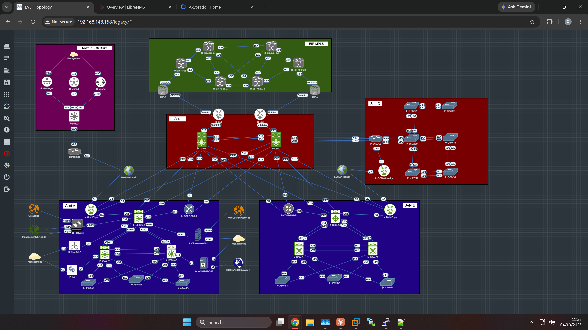

*The lab in EVE-NG, October 2026. Both firewalls now sit inside Gret A, and the green block at the top is the MPLS provider network.*

---

## At a glance

| | |
|---|---|
| **Scale** | About 45 EVE-NG nodes, 32 of them network devices under configuration backup, plus 14 routers being added for the [next build](#roadmap) |
| **Operating systems** | Cisco NX-OS, IOS-XE, IOS-XR, IOS |
| **Sites** | Gret A and Belv B (campuses), Site Q (branch), a shared core, and an MPLS provider network |
| **Separation** | 4 VRFs: CISCO-CORP, SCADA, PLc, DMZ |
| **Routing** | OSPF (multiple processes and areas, VRF-aware), MPLS L3VPN with BGP between the provider edge routers |
| **WAN** | Cisco Catalyst SD-WAN overlay, GRE-over-IPsec tunnels, MPLS L3VPN |
| **Multicast** | PIM sparse-mode, SSM, anycast rendezvous point with MSDP |
| **Security** | Palo Alto with GlobalProtect remote access, OPNsense with IPsec and WireGuard remote access, Cisco ISE, TACACS+, RADIUS with phone-based MFA |
| **Operations** | LibreNMS, Oxidized, Akvorado, FreeRADIUS, tac_plus, Ansible, custom health checks |

### Plain-language translation

Networking carries a lot of jargon. Here's what the terms on this page mean without it, and where each one shows up in the lab.

| Term | In plain language | Where it's used here |
|---|---|---|
| **VRF** | One physical box behaving as several separate routers. Traffic in one VRF can't reach another unless you deliberately join them. | How the office, industrial and DMZ networks share hardware without sharing risk |
| **OSPF** | How routers tell each other which networks they can reach. "Areas" divide that up, so a change in one place doesn't make every router everywhere recalculate. | Every site and the core |
| **BGP** | The routing protocol used *between* networks run by different people. It carries routes across organisations, with rules about which paths to prefer. | Between the MPLS provider's edge routers, with much more of it in the [next build](#roadmap) |
| **MPLS L3VPN** | A provider network that carries several customers' traffic over the same routers while keeping each one private. **PE** routers sit at the provider's edge, **P** routers in its middle, and **CE** routers on the customer's side. | The EIR-MPLS block |
| **SD-WAN** | Joining sites over any internet connection, with central controllers deciding how traffic should travel instead of each router being configured by hand. | vManage, vSmart, vBond and an edge router at each site |
| **GRE over IPsec** | A tunnel that wraps traffic inside other traffic (GRE), then encrypts it (IPsec), so private networks can cross ones you don't trust. | Between CORP-PBR-A and CORP-PBR-B |
| **Policy-based routing and IP SLA** | Sending traffic down a chosen path based on where it comes from, rather than whatever the routing table prefers. A probe (IP SLA) checks the path is alive and moves the traffic if it isn't. | CORP-PBR-A and CORP-PBR-B |
| **QoS and shaping** | Deciding which traffic goes first when a link is busy. A shaper slows a link down on purpose, so the queuing has something to do and you can see it working. | CORP-PBR-A |
| **Multicast** | Sending one copy of a stream that the network duplicates only where it's needed, rather than one copy per receiver. Used for video, market data and industrial telemetry. The **rendezvous point** is where senders and receivers find each other; **anycast** gives two routers the same address so either can do that job. | All three sites |
| **TACACS+ and RADIUS** | Two ways of checking who may log into network equipment, and what they're allowed to type once they're in. | Device logins, through Cisco ISE |
| **MFA with a one-time code** | Logging in takes the password *and* a six-digit code from a phone app, which changes every 30 seconds and can only be used once. | Device logins |
| **SNMP** | How a monitoring system asks devices for their counters and health: traffic, errors, CPU, uptime. | LibreNMS |
| **NetFlow** | Devices report a summary of every conversation crossing them (who talked to whom, and how much) to a collector. Metadata, not packet capture. | Akvorado |
| **Configuration backup** | A system that logs into every device on a schedule, saves its configuration and keeps every version, so any change shows up as a before-and-after comparison. | Oxidized, which is also where the configs in this repo come from |
| **RESTCONF and NETCONF** | Reading and changing a device's settings through an API, as structured data over HTTPS or SSH, instead of typing commands. | CORP-PBR-A |
| **Control-plane policing** | Rate-limiting the traffic aimed *at* a device itself, such as logins and routing updates, so a flood can't overwhelm its processor. | See [Verify it yourself](verify.md) |

---

## Architecture

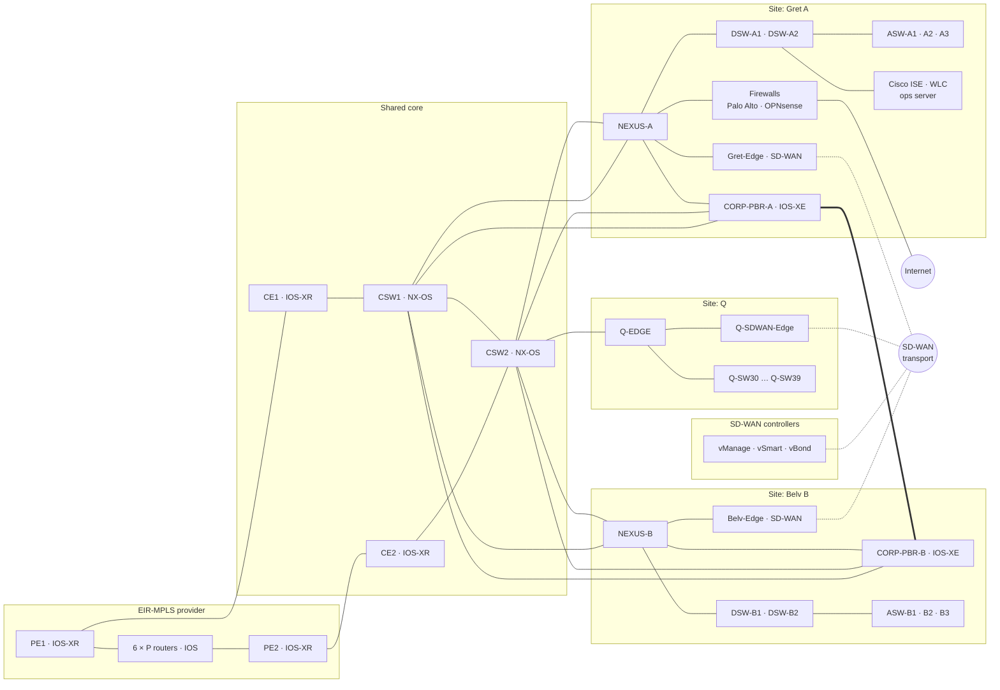

`===` GRE-over-IPsec tunnel pair · dotted lines are the SD-WAN overlay · solid lines are routed links. This is simplified; the screenshot above shows every link.

Each campus has a Nexus switch at the boundary between site and core, holding the default gateways for the user networks. The two CORP-PBR routers exist because the virtual Nexus platform can't do policy-based routing or IPsec. They're a workaround, not a design choice.

Both firewalls now sit inside Gret A, behind NEXUS-A, so remote-access users arrive in a site rather than at the core. Cisco ISE and the operations server live there too. CE1 and CE2 connect the shared core to the MPLS provider network.

---

## Addressing

| Range | Purpose |
|---|---|
| `10.1.0.0/24`, `10.2.0.0/24`, `10.4.0.0/24` | Gret A user networks |
| `10.1.1.0/24`, `10.2.1.0/24`, `10.4.1.0/24` | Belv B user networks |
| `10.98.0.0/24`, `10.98.2.0/24` | Site services |
| `10.99.0.0/24` · `10.99.1.0/24` · `10.99.2.0/24` | Management for Gret A · Belv B · Site Q |
| `10.99.99.0/24` | Management for the routers in the [next build](#roadmap) |
| `10.99.250.0/24` | Device loopbacks (stable identity for monitoring) |
| `10.10.x.0/30`, `10.20.x.0/30` | Point-to-point links between core devices |
| `172.16.12.0/30`, `172.16.12.4/30` | GRE tunnel endpoints |
| `10.255.100.1/32` | Anycast rendezvous point (same address on two routers) |

Management is a separate network per site with its own gateway. Every device sends SNMP, syslog, authentication and NetFlow from that network, keeping management traffic separable from user traffic.

---

## What runs on it

### Routing and separation
Four VRFs are carried consistently from core to branch: `CISCO-CORP` for users, `SCADA` and `PLc` for isolated industrial networks, and `DMZ` for management and services. Each has its own OSPF process, so the four routing domains are genuinely independent rather than filtered versions of one.

The campus Nexus switches are area border routers: user networks in area 10 (Gret A) and area 20 (Belv B), core in area 0, with route summarisation and filtering at the boundary.

### MPLS L3VPN
A provider network built the way a real one is: six IOS routers in the middle (P routers) and two IOS-XR provider edge routers, PE1 and PE2, running OSPF and LDP between them, with BGP carrying the VPN routes from one edge to the other. Three of the four VRFs (SCADA, PLc and CISCO-CORP) cross it, each kept separate by its own route distinguisher. CE1 and CE2 connect the shared core to it.

It works, and it carries no traffic.

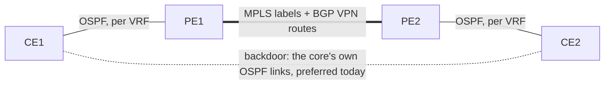

The sites can already reach each other through the core's own OSPF links, and OSPF prefers a route it learns directly inside an area over the same route passed across a provider. That's the classic "backdoor" problem. The fix is either a sham-link or taking the backdoor away, and the [next build](#roadmap) does the second.

### Path control
Policy-based routing on both CORP-PBR routers is designed to split traffic from two user networks across different core switches. On CORP-PBR-B that split isn't working yet ([see below](#whats-wrong-with-it)). Each path is watched by an IP SLA probe with a tracked object, so if a core switch stops responding the traffic moves. If *every* tracked path fails, the policy stands aside and lets normal routing take over rather than dropping traffic. That's worth knowing, because the alternative is a silent blackhole.

### WAN and encryption
A Catalyst SD-WAN overlay (vManage, vSmart, vBond and three edge routers), plus two GRE-over-IPsec tunnels between the CORP-PBR routers taking different physical paths through the two core switches. Both run OSPF inside the tunnel and have their MTU clamped, which avoids a well-known failure where small packets pass and large ones vanish.

<p align="center">
  <a href="evidence/SDWAN-Dashboard.png">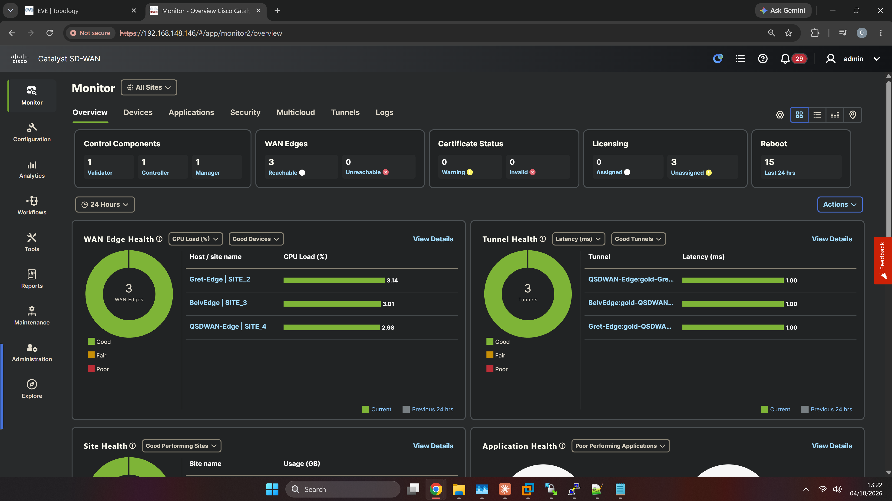</a>
  <a href="evidence/SDWAN-Device-List.png">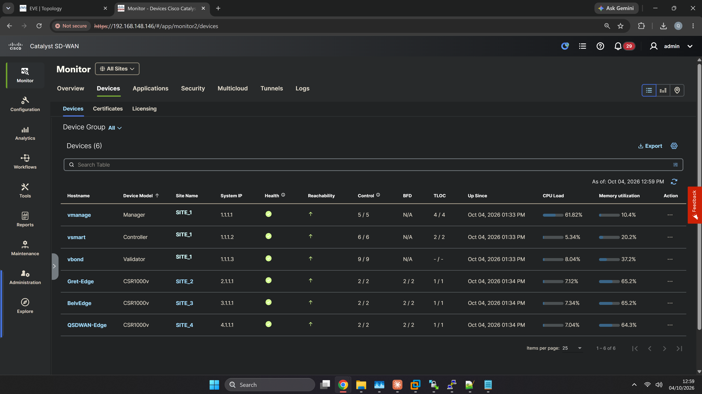</a>
</p>

*vManage: the overlay's dashboard, and the controllers and edge routers it manages. Click any screenshot for the full-size version.*

### Multicast
PIM sparse-mode across all three sites, inside a VRF. Two routers share one rendezvous-point address (anycast), with MSDP peering between them so a source registering with one is visible to the other. Failover was tested by shutting the loopback on one and watching traffic continue. SSM and IGMPv3 are also configured.

### Quality of service
Traffic is marked as it enters CORP-PBR-A. The queuing policy, and the shaper that creates artificial congestion so the queuing can actually be observed, are switched on for tests rather than left running. Without the shaper none of it does anything visible, which is the part most tutorials skip. The one time the shaper was left on, it throttled all inter-site traffic to 1 Mbps ([more below](#whats-wrong-with-it)).

### Security and access control
Palo Alto and OPNsense, as two different firewall platforms, deliberately. Cisco ISE is the policy engine for device logins across 26 devices, including per-command authorisation: a read-only account logs in successfully and is still refused `configure terminal`.

On top of that, multi-factor authentication: ISE passes the login to FreeRADIUS, which checks a rotating six-digit code from a phone authenticator app before allowing it.

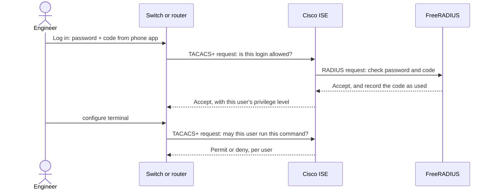

<p align="center">
  <a href="evidence/ISE-TACACS-Live-Logs.png">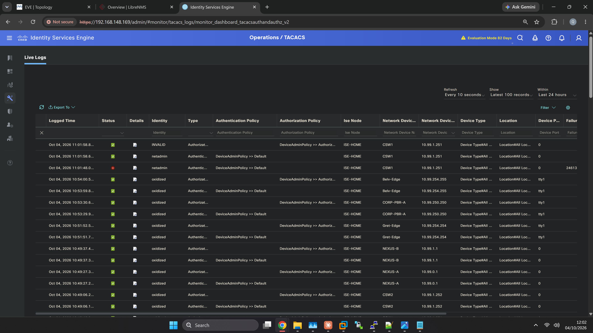</a>
</p>

*ISE's TACACS+ live log: every login and command authorisation, per device and per user.*

<p align="center">
  <a href="evidence/PaloAlto-Dashboard.png">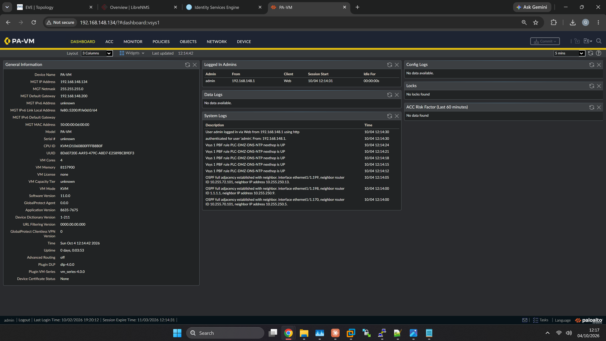</a>
  <a href="evidence/OPNsense-Dashboard.png">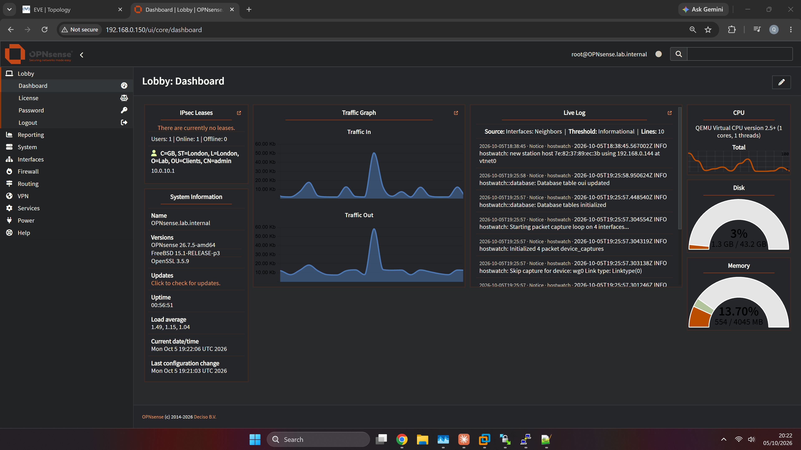</a>
</p>

*The two firewalls: Palo Alto PA-VM and OPNsense.*

### Remote access
Both firewalls terminate remote-access VPNs from outside the lab. Palo Alto runs GlobalProtect. It was lost in the April rebuild and has been working again since October, reachable from the internet. OPNsense runs IKEv2 IPsec and WireGuard, used from a phone, giving access to the management networks.

<p align="center">
  <a href="evidence/PaloAlto-GP-Logs.png">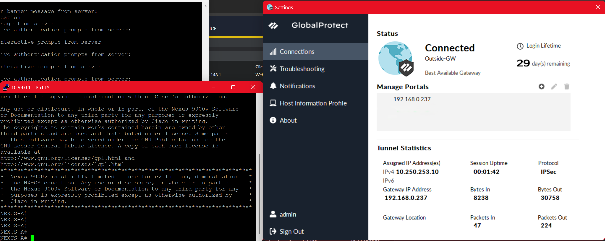</a>
  <a href="evidence/PaloAlto-GP-Logs-blurred.png">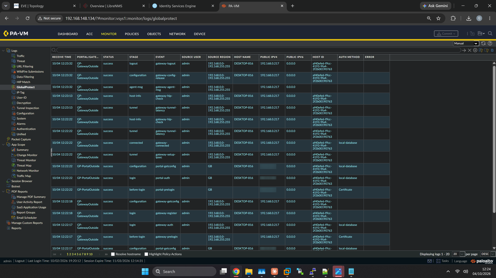</a>
</p>

*Left: GlobalProtect connected, with traffic in both directions and an SSH session to NEXUS-A open. Right: the matching portal and gateway logs on the firewall. Public addresses are blurred.*

<p align="center">
  <a href="evidence/OPNsense-IPsec-Status.png">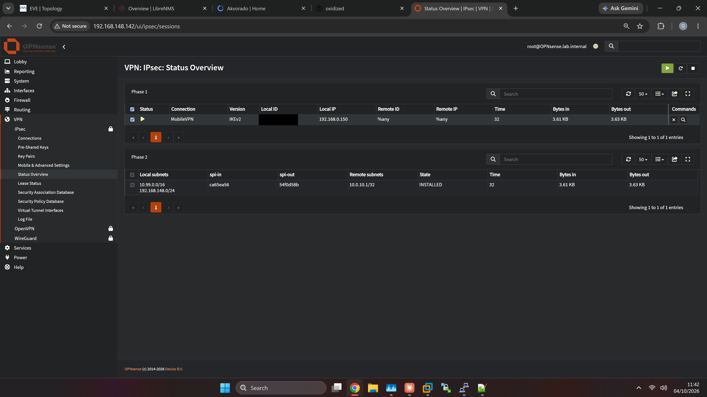</a>
  <a href="evidence/strongSwan-Status-blurred.png"></a>
  <a href="evidence/WireGuard-Peer-blurred.png">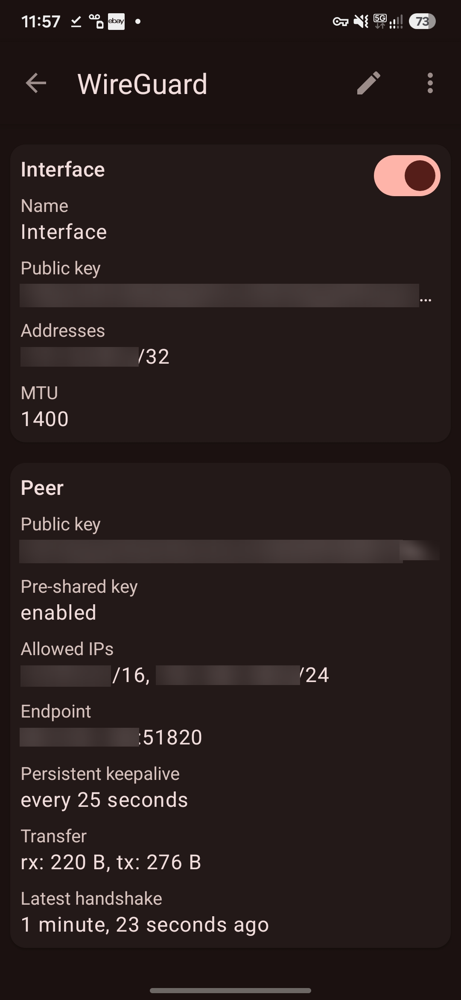</a>
</p>

*OPNsense with an IKEv2 session up, and the phone end of both VPNs.*

### Automation
RESTCONF and NETCONF are enabled on IOS-XE and used to read the configuration *and* change it, such as setting interface descriptions over HTTPS rather than typing them at a CLI. YangSuite (in Docker) is there for exploring the data models. Ansible now pushes baseline settings to the IOS-XE devices from an inventory grouped by site and by platform, with first playbooks written for NX-OS and IOS-XR.

---

## The operations stack

The part that turns a topology into something that has to be *run*. All of it lives on one Ubuntu 24.04 server on the management network.

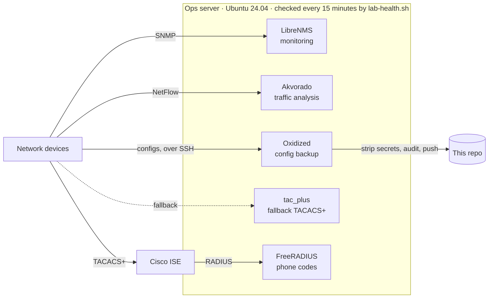

### LibreNMS: monitoring
SNMP polling across the estate: interface throughput and errors, device health, availability alerting. Setting it up properly meant working through polling-interval tuning, RRD step conversion, `rrdcached`, PHP timezone problems and SNMPv3 credentials. None of it is interesting until it's wrong, and all of it is part of running a monitoring platform.

<p align="center">
  <a href="evidence/LibreNMS-Dashboard.png">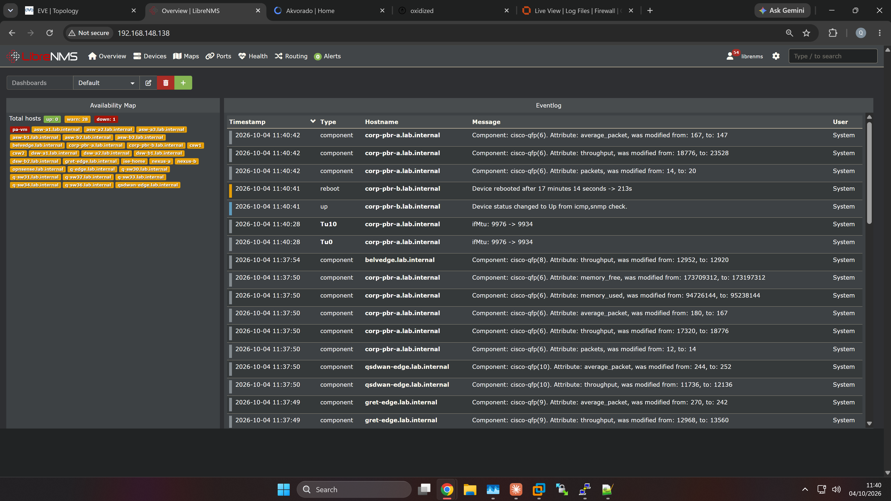</a>
  <a href="evidence/LibreNMS-Device-List.png">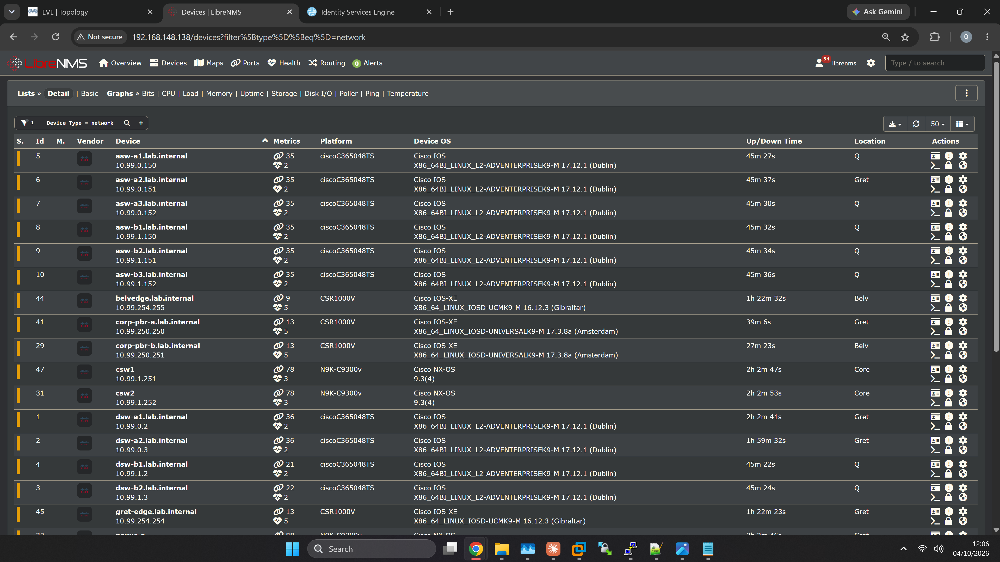</a>
</p>

*LibreNMS: the overview dashboard and the device list.*

### Oxidized: configuration backup
Every device's config pulled into a git repository on a schedule, so any change is a diff. That history is how I found several of the problems described on this page, and it's what keeps the published configs in this repo current. It's also the closest thing the lab has to a rollback mechanism.

It's here because I learned the hard way: when I moved the lab to a new machine in April, backups weren't fully working yet and most of it had to be rebuilt by hand ([more below](#the-year-behind-it)).

<p align="center">
  <a href="evidence/Oxidized-Config-Diff.png">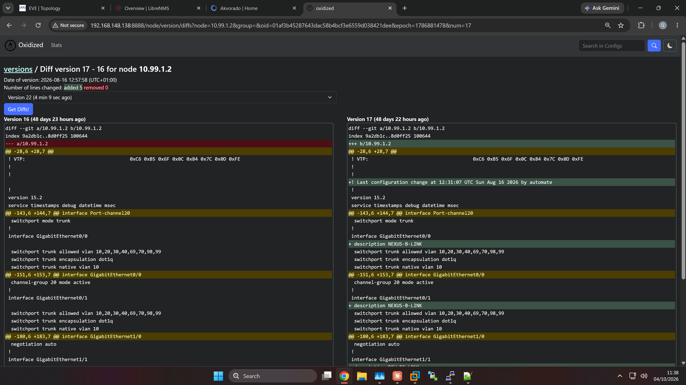</a>
  <a href="evidence/Oxidized-Version-History.png">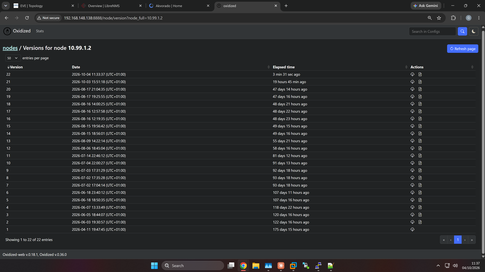</a>
</p>

*A config change shown as a diff, and the version history behind it.*

### Akvorado: traffic analysis
NetFlow collection with a ClickHouse and Kafka pipeline behind it, fed by three exporters (both CORP-PBR routers and the branch edge). Networks are named per site, so flows read as `gret-a-vlan20 → belv-b-vlan20` rather than raw addresses.

Getting flows to land took real debugging. First, NetFlow v9 templates expired while the collector restarted. Then a subtler one: every flow decoded perfectly and was then discarded, because the collector requires a sampling rate that unsampled IOS export never advertises. Found by reading the collector's own metrics, spotting an exact 1:1 ratio between decoded flows and `sampling rate missing` errors, and confirming it in the source.

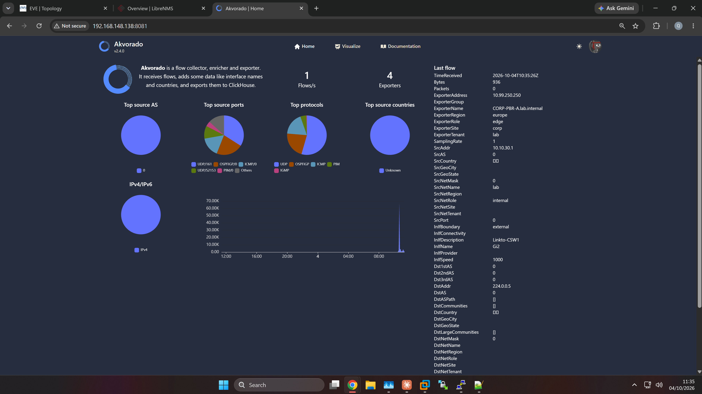

### FreeRADIUS and tac_plus: authentication
FreeRADIUS provides RADIUS and the one-time-code engine (PAM plus Google Authenticator). `tac_plus` is a standalone TACACS+ server built from source, kept as a fallback and as a plain reference implementation next to ISE's much larger one.

### `lab-health.sh`: custom health checking
A Bash script on a systemd timer, every fifteen minutes. Every check in it corresponds to something that actually went wrong:

- Host basics: filesystem writable, disk space, **clock synchronised** (out-of-sync clocks silently break time-based one-time codes), resolver and Docker alive
- **Who owns the ports** (2055, 49, 1812, 1813), because a leftover process squatting on the NetFlow port put the collector into a crash loop more than once
- Container health, including a specific check for a container-DNS failure with the same effect
- **Functional tests, not just "is it running":** a deliberately wrong RADIUS login that must be rejected; SNMP polls to each NetFlow exporter (which double as the collector's own prerequisite); a database freshness query broken down per exporter
- Two specific settings that let logins keep working **while quietly switching off the rule that stops a phone code being used twice**. That's the dangerous kind of failure, because nothing looks wrong

It reports pass/fail, exits non-zero when something's broken, and with `--fix` repairs what's safe to repair automatically.

<p align="center">
  <a href="evidence/lab-health.sh-output.png">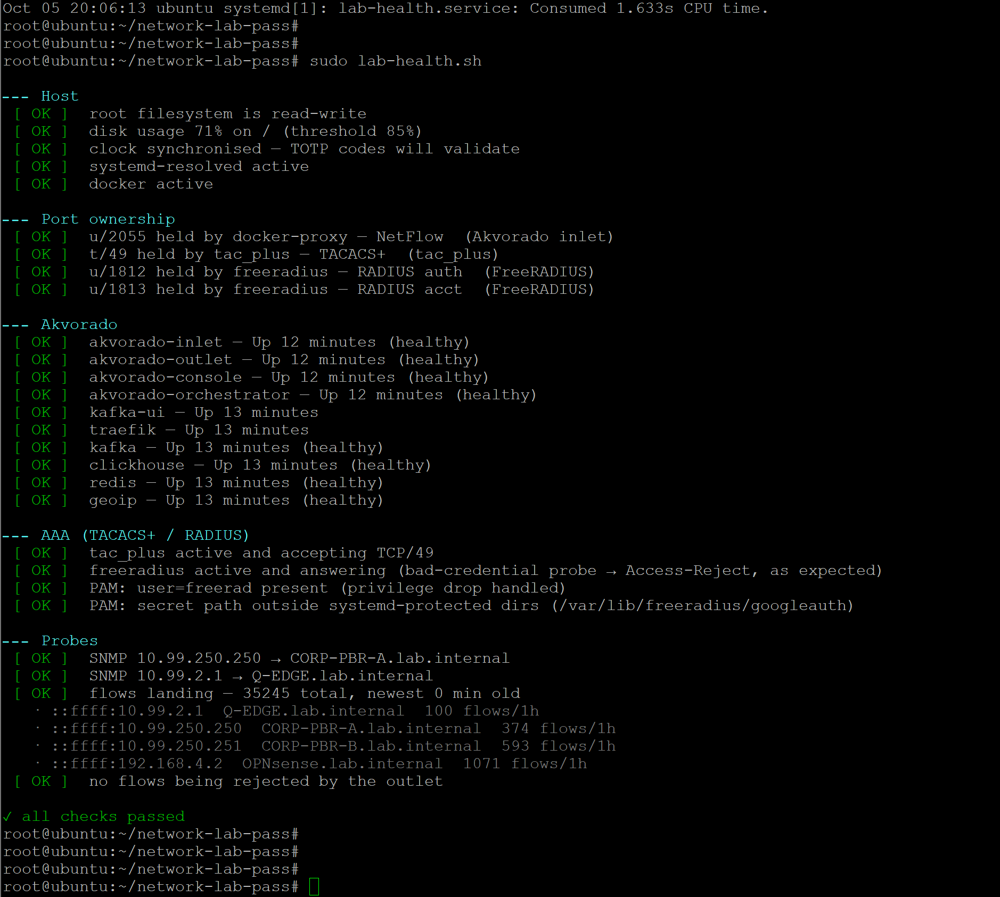</a>
</p>

### What the ops stack taught me
More than the network config did. Integrating five independent systems that were never tested together on one host is a large part of what infrastructure work involves. The failures were rarely exotic: port conflicts, systemd sandboxing making a directory read-only inside a service but not outside it, a PAM module trying to drop privileges to a user that didn't exist, and a monitoring script that gave different answers on identical runs because of a shell race between `pipefail` and `grep -q`.

---

## What I learned the hard way

**Virtual platforms will lie to you.** A switch port passed CDP (the neighbour appeared correctly) but forwarded no actual traffic. The switch even had an ARP entry for the far end, which turned out to have been learned from the far end's own broadcasts rather than from any reply. Moving the same virtual machine to a different switch fixed it instantly. When the control plane says yes and the data plane says nothing, bisect the path instead of re-reading the config.

**Configuration can be valid and completely inert.** Route summarisation configured for an area containing no interfaces. `default-information originate` in VRFs with no default route to originate. Both passed review. Neither did anything.

**Filtering routes on a transit router can create a blackhole.** Removing a route from one router's own table doesn't stop it advertising that path to everyone else, so neighbours keep sending traffic to a router that can no longer forward it. Reproduced deliberately and traced hop by hop, which taught me more than reading about it would have.

**Overlapping addresses fail in confusing ways.** Monitoring for both core switches kept failing. Two things were wrong at once: their management loopbacks overlapped the DMZ subnet, so ARP answers came from the wrong place, and one switch also had an SNMPv3 security-level mismatch. An address plan only protects you if something checks it for overlaps.

**A network can work perfectly and carry nothing.** Once the MPLS VPN was rebuilt on the right routers, the BGP session came up and 30 routes were exchanged, yet no traffic used it, because OSPF preferred the core's own links. "Working" and "in use" are different questions; check the path traffic actually takes, not just the routing table.

**Old software and new tools don't always share a language.** Older IOS images only offer SSH key-exchange methods that modern clients refuse. It broke Ansible on three routers and file transfers from vManage to an SD-WAN edge. When a connection fails before the password prompt, read the error before resetting any passwords.

**Anything you expose gets found.** Once the GlobalProtect portal was reachable from the internet, its logs filled with login attempts from scanners in several countries. They all failed at the client-certificate check, but "it's only a lab" stopped being true the moment it had a public address.

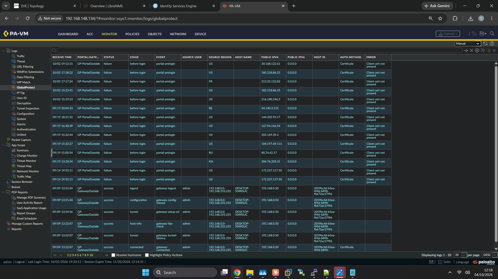

**A security feature can switch itself off without anything looking wrong.** A one-time code only works if the server records that it's been used, so nobody can use it again. Twice during the build that recording step silently failed: once because the software tried to switch to a user account that didn't exist, and once because the file it needed sat in a folder the service wasn't allowed to write to.

Both times, logins carried on working perfectly, with no error and nothing in the logs I was watching; codes had simply become reusable, which is the entire point of the feature. It's the failure I think about most, and the health checker now tests for both cases every fifteen minutes.

---

## What's wrong with it

The section I'd want to read if someone showed me this. The first version of this page listed eight problems; this is where each one stands now.

| Problem in the first version | Where it stands (October 2026) |
|---|---|
| Over-engineered for its size | Still true, and deliberate (see below) |
| MPLS and BGP configured on the wrong routers | **Fixed.** Rebuilt on the provider edge routers. It now works but carries no traffic ([backdoor](#mpls-l3vpn)) |
| Policy-based routing configured but never checked | **Half fixed.** CORP-PBR-A now splits the two user networks; CORP-PBR-B still sends both down the same path |
| A test shaper left throttling inter-site traffic to 1 Mbps | **Fixed.** The shaper is no longer applied, but the habit behind it is still there (see below) |
| Lab-grade credential handling | Still true |
| Everything runs on one server | Still true |
| Not reproducible | **Partly addressed.** Ansible now pushes baseline settings, and a [build guide](build-it-yourself.md) covers rebuilding the lab by hand; most configuration is still typed by hand |
| Backups have never been restored | Still true |

**It's over-engineered for its size.** Four VRFs, eight OSPF processes and three sites for around 30 devices is a feature-density decision, not an engineering one. A real network this size would be far simpler, and anyone proposing this design for 30 real devices should be challenged on it. It's a study environment, so the complexity is the point, but nobody should mistake it for good design at this scale.

**Things still get configured and not verified.** Policy-based routing was meant to split two user networks across different core switches. A config review found the primary and backup next-hops in the wrong order on both routers, so everything had quietly been using one path. CORP-PBR-A is fixed; the latest config from CORP-PBR-B still has both networks preferring the same next hop. Same lesson as the first time: I checked the configuration, not the behaviour.

**Change discipline is thin.** The 1 Mbps shaper went in for a test and was still there through three separate config reviews. It's gone now, but changes still go in with no record beyond Oxidized diffs, no pre-change checks and no test plan. In production that pattern causes outages.

**Credential handling is lab-grade and would fail an audit.** Several devices still keep a local account as a reversible type-7 password, and shared secrets are reused across services. Fine for a lab; genuinely bad if it were real. It's also why nothing here is published without going through a sanitiser first.

**Everything runs on one server.** LibreNMS, Oxidized, the NetFlow collector, RADIUS and TACACS+ all sit on a single Ubuntu box with no redundancy. If it dies I lose monitoring, backups, flow data *and* authentication at once. Losing authentication would lock me out of the devices too, if the local fallback accounts weren't there.

**It's only partly reproducible.** An Ansible inventory and baseline playbooks now push common settings, but most configuration is still typed or pasted by hand, with no single source of truth to rebuild from. April showed what that costs. The [build guide](build-it-yourself.md) lets someone rebuild most of the lab by hand, but it takes weeks of evenings, there's no lab export file, and the firewalls, ISE, the SD-WAN controllers and the MPLS provider routers have no published config. That's the biggest gap between this and how a modern network team works.

**Backups have never been restored.** Oxidized has been collecting configs for months. I have never once tested putting one back.

---

## The year behind it

Twelve months ago I didn't have a CCNA. I'm now preparing to sit CCNP ENCOR, and everything in this repository was built in the gaps around a full-time NOC support role.

There was no trick to it, but there was a lot of time. An hour or two on a normal weekday, before shifts or after them. And then the stretches that weren't normal: four, five, six hours a day across a whole weekend, disappearing into firewall configuration or standing OPNsense up from nothing. Some features went in over an evening. Some ate an entire weekend and were still broken on Sunday night.

**In April I lost the lab.** I moved from a 32GB laptop to a 128GB one, and because my configuration backups weren't fully working yet, most of it didn't come with me. I rebuilt it by hand. A working Palo Alto GlobalProtect VPN setup, which had taken a long fight to get going, didn't come back until October.

That's the honest origin of the operations stack on this page. Oxidized isn't here because a course told me to install it; it's here because I've already paid for not having it, and rebuilding thirty devices from memory is a lesson you only need once. The same goes for the health checker: it exists because things kept breaking silently, and I got tired of finding out days later.

Most of the time wasn't glamorous. A fair share went on things that turned out to be my own mistake, a virtual platform quietly not doing what it claimed, or a Linux service failing for reasons that had nothing to do with networking. The lessons and criticism sections above are mostly a record of that. I've left them in because the polished version would be less useful to anyone reading this, and less true.

**If you're roughly where I was a year ago,** four things helped more than anything else:

- **Keep one lab running instead of rebuilding it per topic.** Consequences accumulate. Half of what I learned came from something I'd configured weeks earlier breaking when I touched something unrelated, and that's the part that actually resembles the job.
- **Break things deliberately, then predict the symptom before you look.** Being able to *recognise* a failure is worth more than being able to configure the feature, and it's the harder half to pick up from a book.
- **Write it down as you go, and back it up sooner than you think you need to.** The runbooks in this repo exist because I needed them, not because I planned to publish them. The backups exist because I learned the alternative in April.
- **Steady days get you there; the long ones move you forward.** Most progress came from ordinary weekday hours. But the things I understand best are the ones I lost a weekend to, sitting with something broken long enough to actually work it out rather than reading the answer.

None of this required expensive kit or a lot of money: EVE-NG on a decent machine, free tooling, and time. It did require a genuine amount of that last one, and I'd rather say so than pretend it was effortless. If you're working in a NOC and wondering whether the jump to engineering-level work is realistic alongside shift work: it is. It's slow, it's occasionally demoralising, and it is absolutely possible.

---

## Roadmap

The next build follows my CCNP ENARSI study. The plan is to replace the shared core with separate provider networks, each running a different routing protocol, and connect every site's edge router to all of them. The two ISPs also peer with each other directly.

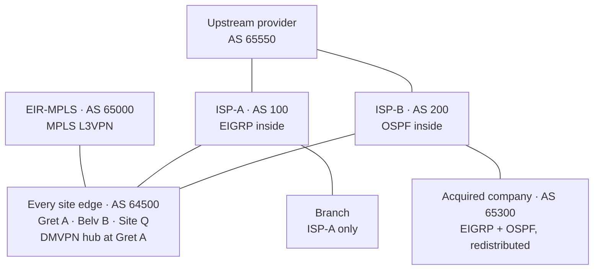

| Status | What |
|---|---|
| **Done** | MPLS L3VPN rebuilt on the provider edge routers |
| **Done** | GlobalProtect remote access rebuilt, reachable from the internet |
| **Done** | Both firewalls moved into Gret A |
| **Done** | Ansible inventory and baseline playbooks |
| **Underway** | The ENARSI build above. Fourteen new routers are in, with their own management network, monitoring and backups. Routing phases follow: EIGRP, OSPF, BGP policy, redistribution, the MPLS cutover, then DMVPN |
| **Next** | Fix policy-based routing on CORP-PBR-B |
| **Next** | Restore a config from Oxidized onto a live device, end to end |
| **Next** | Hashed secrets everywhere: type 9 for accounts, type 6 for keys |
| **Next** | Realistic traffic from a TRex traffic generator |
| **Later** | 802.1X network access control with ISE · SD-WAN centralised policy and application-aware routing · a jump server for admin access |

---

## Repository contents

```
├── configs/           # sanitised device configs, one file per management address
├── enarsi/configs/    # sanitised configs for the next build's routers
├── docs/              # this page, Verify it yourself, the build guide, phase runbooks
│   └── evidence/      # the screenshots on this page
├── diagrams/          # EVE-NG topology exports
└── scripts/           # publish script, sanitiser, health check, RESTCONF tools, Ansible playbooks, YangSuite
```

See [Verify it yourself](verify.md) for commands you can run to check these claims rather than take them on trust, [Build it yourself](build-it-yourself.md) to set the lab up on your own PC, and the [runbooks](https://github.com/qa711/network-lab/tree/main/docs/runbooks) for the build notes behind each study phase.

Configurations are collected by Oxidized and published by a script that strips secrets and refuses to push if any survive. What's here reflects how the lab ran at the last sync, including whatever was broken at the time.

**About AI help:** I've used Claude, an AI assistant, throughout: as a study partner, for config reviews and for lab workbooks. Some of the scripts in `scripts/` were written with its help. The lab was built and is run by me, and its configs are published here so the claims on this page can be checked.
